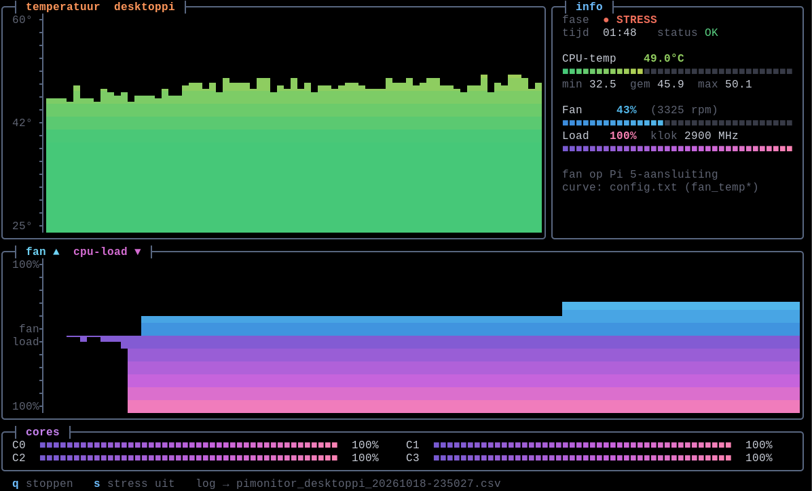

# pi-fan-monitor

A terminal dashboard for the **CPU temperature and fan of a Raspberry Pi**, with a built-in stress test. It is made for tuning a fan curve: you watch temperature, fan speed and CPU load side by side in real time, and when you stop you get a log file and a chart.



## Features

- Live temperature graph with a colour gradient (green → yellow → orange → red)
- Fan speed and CPU load in one mirrored graph, so you can see right away whether the fan follows the load smoothly or keeps switching on and off
- Per-core load meters, clock speed and throttle status (`vcgencmd get_throttled`)
- **Real fan readings on the Pi 5**: PWM level and RPM from the Pi 5 fan header
- **Argon ONE support** (Pi 4): reads the fan curve from `/etc/argononed.conf` and shows whether the Argon daemon is running
- Step-by-step guide to a quieter fan curve (see [Setting the fan curve](#setting-the-fan-curve))
- Built-in stress test: toggle it with one key, or run an automatic idle → stress → cool-down sequence
- Saves every measurement as **CSV**, draws an **SVG chart** and prints a summary per phase
- No dependencies: only the Python 3 standard library

## Installation

```bash
curl -O https://raw.githubusercontent.com/davyschroeder/pi-fan-monitor/main/pi-fan-monitor.py
chmod +x pi-fan-monitor.py
```

Or clone the repository:

```bash
git clone https://github.com/davyschroeder/pi-fan-monitor.git
cd pi-fan-monitor
```

Optional, for a heavier and more realistic stress test:

```bash
sudo apt install stress-ng
```

Without `stress-ng`, pi-fan-monitor uses a built-in Python load on all cores.

## Usage

```bash
python3 pi-fan-monitor.py                 # live monitoring
python3 pi-fan-monitor.py --stress        # automatic test: 1 min idle, 5 min stress, 3 min cool-down
```

| Key | Action |
|---|---|
| `q` | stop and save the results |
| `s` | toggle the stress test (only without `--stress`) |

### Options

| Option | Default | Description |
|---|---|---|
| `--stress` | off | run the automatic stress test sequence |
| `--idle N` | 60 | seconds of idle measurement before the stress phase |
| `--load N` | 300 | seconds of stress |
| `--cool N` | 180 | seconds of cool-down after the stress phase |
| `--interval N` | 1 | seconds between measurements |
| `--duration N` | – | stop after N seconds (without `--stress`) |
| `--fan auto\|curve\|pwm` | auto | where the fan reading comes from (see below) |
| `--braille` | off | finer braille graphs; only looks good if your font renders braille well |
| `--version` | | show the version |

Example: a 30-minute stability test after overclocking:

```bash
python3 pi-fan-monitor.py --stress --idle 30 --load 1800 --cool 300
```

## Output

When you stop, the current directory contains:

- `pi-fan-monitor_<host>_<date-time>.csv`: all measurements (time, phase, temperature, fan %, RPM, load, clock, throttle status)
- `pi-fan-monitor_<host>_<date-time>.svg`: a chart of temperature, fan and load with the stress phase highlighted; open it in a browser

The terminal shows a summary per phase: minimum, maximum and final temperature, the highest fan level, **how many times the fan changed speed**, and whether the Pi throttled. The number of speed changes is a good way to compare fan curves: the lower it is, the calmer the fan.

## Supported fans

pi-fan-monitor is made for two kinds of Raspberry Pi fans. It detects which one you have automatically.

| Fan connection | Examples | Fan curve is set in | What pi-fan-monitor shows |
|---|---|---|---|
| **Pi 5 fan header**: the small 4-pin JST connector on the Pi 5 board, marked `FAN` | official Raspberry Pi Active Cooler, Argon ONE V5, most Pi 5 cases with a fan | `/boot/firmware/config.txt` | measured PWM level and RPM |
| **Argon ONE for the Pi 4**: the fan is driven by the case over I2C | Argon ONE, Argon ONE M.2 (Pi 4) | `/etc/argononed.conf` | the level the Argon daemon picks from its curve; this fan has no RPM sensor |
| No fan found | | | `–` |

Fans on the GPIO 5V pins without a control wire run at a fixed speed and cannot be measured.

Use `--fan curve` or `--fan pwm` to force a source.

### Which one do I have?

```bash
grep -l pwmfan /sys/class/hwmon/hwmon*/name      # a result: Pi 5 fan header
ls /etc/argononed.conf                            # file exists: Argon ONE (Pi 4)
```

On a Pi 5 you can also test the fan by hand. This runs it at full speed for 5 seconds, prints the RPM and hands control back to the Pi:

```bash
F=$(dirname $(grep -l pwmfan /sys/class/hwmon/hwmon*/name))
echo 1   | sudo tee $F/pwm1_enable >/dev/null     # manual control
echo 255 | sudo tee $F/pwm1 >/dev/null            # full speed
sleep 5; cat $F/fan1_input                        # RPM, should be well above 0
echo 2   | sudo tee $F/pwm1_enable >/dev/null     # back to automatic
```

## Setting the fan curve

### Pi 5 fan header: `config.txt`

The Pi 5 firmware controls the fan itself. By default it only starts the fan at 50 °C and then steps up in large increments (50, 60, 67.5 and 75 °C). The result is a fan that kicks in hard, cools the Pi quickly and stops again. A curve that starts lower, uses smaller steps and has **hysteresis** keeps the fan calm.

1. Open the boot configuration:

   ```bash
   sudo nano /boot/firmware/config.txt
   ```

   On Raspberry Pi OS Bullseye and older the file is `/boot/config.txt`.

2. Scroll to the bottom. Make sure the lines end up in the `[all]` section, not under a model filter such as `[cm4]` or `[pi4]`. If the last section header in the file is not `[all]`, add a line `[all]` first. Then add:

   ```ini
   [all]
   dtparam=fan_temp0=40000
   dtparam=fan_temp0_hyst=5000
   dtparam=fan_temp0_speed=60
   dtparam=fan_temp1=50000
   dtparam=fan_temp1_hyst=5000
   dtparam=fan_temp1_speed=110
   dtparam=fan_temp2=60000
   dtparam=fan_temp2_hyst=5000
   dtparam=fan_temp2_speed=170
   dtparam=fan_temp3=70000
   dtparam=fan_temp3_hyst=5000
   dtparam=fan_temp3_speed=255
   ```

3. Save with `Ctrl+O`, `Enter`, close with `Ctrl+X` and reboot:

   ```bash
   sudo reboot
   ```

4. Check the result:

   ```bash
   python3 pi-fan-monitor.py --stress
   ```

What the values mean:

| Parameter | Meaning | Example |
|---|---|---|
| `fan_tempN` | temperature at which step N starts, in thousandths of a degree | `40000` = 40 °C |
| `fan_tempN_speed` | fan speed for step N, from 0 (off) to 255 (full) | `60` ≈ 24 % |
| `fan_tempN_hyst` | how far the temperature must drop before the fan goes back down a step | `5000` = 5 °C |

There are four steps (0 to 3), and the temperatures must go up from step to step. Below `fan_temp0` the fan is off. To keep the fan spinning quietly at all times, lower `fan_temp0`, for example to `35000`.

Hysteresis is what stops the on/off pumping: with `hyst=5000`, a fan that switched on at 40 °C only switches off again once the Pi has cooled to 35 °C.

### Argon ONE (Pi 4): `argononed.conf`

The Argon ONE for the Pi 4 controls its fan with the Argon script, not with `config.txt`. Edit the curve with `argonone-config` or directly:

```bash
sudo nano /etc/argononed.conf
```

Each line is `temperature=speed%`, for example:

```ini
30=25
50=35
55=45
60=60
65=80
70=100
```

Restart the service with `sudo systemctl restart argononed`. pi-fan-monitor reads this file and shows the curve and the daemon status in the info panel.

## Requirements

- A Raspberry Pi running Raspberry Pi OS (or another Linux; the temperature is read from `/sys/class/thermal`)
- Python 3.7 or newer
- A terminal with truecolor support, such as Windows Terminal, iTerm2 or most modern Linux terminals; at least 64×22 characters
- `vcgencmd` for the throttle status (included in Raspberry Pi OS)

## License

MIT, see [LICENSE](LICENSE).
